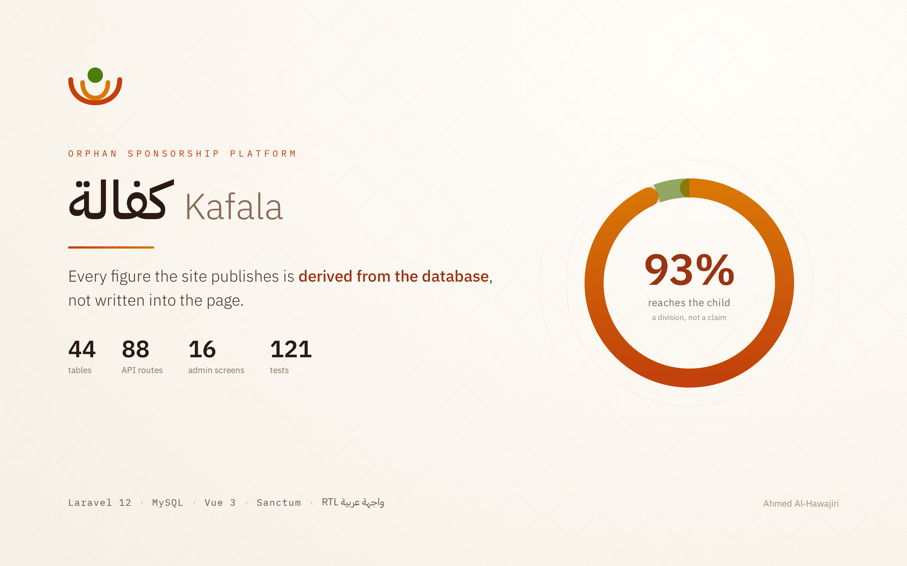

# لمّة — Lamma

<p align="center">
  
</p>

**كل طفلٍ في لمّة أهله.** شبكة كفالة أيتام عالمية «الأسرة أولاً».

*English README: [README.md](README.md)*

[](https://kafala-orphan-sponsorship.vercel.app/)

<div dir="rtl">

> الديمو أعلاه نسخة **ساكنة من الموقع العام وحده** — لعرض التصميم والحركة.
> أما الـ API ولوحة الإدارة وبوابة الكافل فتحتاج PHP و MySQL، وتُشغَّل محلياً
> بخطوتين في [التشغيل](#-التشغيل).

منصة كفالة أيتام كاملة تصل كفلاءً من أي بلد بأطفالٍ يعيشون مع أسرهم، عبر جمعيات
محلية موثّقة: موقع عام بالعربية (RTL أولاً)، وخادم Laravel 12 على MySQL، ولوحة
إدارة Vue 3، وبوابة للكافل. كان اسمها «كفالة»، وتغيّر لأن الاسم عامٌّ تحمله
جمعيات ومشاريع كثيرة (المعرّفات التقنية مثل `config/kafala.php` بقيت كما هي).

الفكرة التي بُني حولها المشروع: **الشفافية**. لا تبرع مجهول المصير، بل طفل باسمه
وقصته وملفه الموثّق، وتقرير مصوّر كل ثلاثة أشهر، وميزانية مدقّقة منشورة للجميع.

وهذا المبدأ ليس شعاراً في الصفحة الرئيسية: **كل رقم يعلنه الموقع مُشتقٌّ من قاعدة
البيانات، لا مكتوبٌ في الواجهة.** حلقة الإنفاق تُجمَّع من صرفٍ معتمَد، ونسبة «٩٣٪
تصل للطفل» ناتج قسمة، وعدد الزيارات الميدانية `COUNT(*)`.

</div>

---

## 🧭 البنية

```
kafala-orphan-sponsorship/
│
├── api/                    Laravel 12 · PHP 8.2 · MySQL · Sanctum
│   ├── app/  database/     ١٢٬٤٠٠ سطر
│   ├── resources/views/    ← الموقع العام: قوالب Blade (site/ و errors/)
│   └── public/
│       ├── assets/         CSS و JS والصور: الموقع يملأ محتواه الحيّ من الـ API
│       └── admin-app/      ← ناتج بناء لوحة Vue (لا يُحفظ في المستودع)
│
└── admin/                  مصدر اللوحة: Vue 3 · Vite · Pinia · Chart.js
```

**نشرٌ واحد لكل شيء.** الموقع العام ولوحة الإدارة والـ API على أصل واحد:

| المسار | ما يُقدَّم |
|---|---|
| `/` · `/about` · `/orphans` … | الموقع العام (‏HTML ساكن، عناوين نظيفة) |
| `/dashboard` | بوابة الكافل |
| `/admin` وما تحته | لوحة الإدارة (‏Vue SPA) |
| `/api/v1/…` | الـ API |

ولأن الأصل واحد فلا CORS، ولا كوكيز عابرة للأصول، و`connect-src 'self'` في
سياسة أمن المحتوى — أضيق صورة ممكنة.

| | |
|---|---|
| جداول قاعدة البيانات | **٤٤** في تسعة نطاقات |
| مسارات الـ API | **٨٨** في أربع مجموعات |
| موديلات Eloquent | ٢٩ · و١٥ enum |
| شاشات لوحة الإدارة | ١٦ |
| اختبارات | ٨٠ Pest · ٢٩ Playwright · ١٢ Vitest |

---

## 🗄 قاعدة البيانات

أربعة وأربعون جدولاً. وهذه أبرز خمسة قرارات في تصميمها:

**١. القيد الجزئي على الكفالات.**
لا يجوز لكافل أن يكفل الطفل نفسه مرتين *في وقت واحد*، لكنه **يجوز** أن يعود بعد
إلغاء. و`UNIQUE(sponsor_id, orphan_id)` العادي يمنع العودة. الحل عمود مُولَّد:

```sql
active_key TINYINT GENERATED ALWAYS AS (
    CASE WHEN status IN ('pending','active','paused') THEN 1 ELSE NULL END
) STORED,
UNIQUE KEY uniq_active_sponsorship (sponsor_id, orphan_id, active_key)
```

‏`NULL` لا يشارك في قيود `UNIQUE` في MySQL، فالصفوف الملغاة تُستثنى تلقائياً.
قيدٌ جزئي حقيقي على محرّك لا يدعم القيود الجزئية.

**٢. `idempotency_key` فريد على المدفوعات.**
الكافل يضغط «ادفع» مرتين، أو تعيد البوابة إرسال الـ webhook. القيد يجعل الخصم
المزدوج مستحيلاً **في المحرّك** لا في انضباط الكود.

**٣. `date_of_birth` لا `age`.** العمر يتغيّر كل عام والتاريخ لا.

**٤. المال `DECIMAL` بعملته وسعر صرفه.** ‏`FLOAT` يفقد السنتات في الجمع.

**٥. `UNIQUE(orphan_id, year, quarter)` على التقارير.** وعد «تقرير كل ٣ أشهر»
صار قيداً لا يمكن خرقه.

---

## 🎨 التصميم

هوية **الفيروزي العميق**: فيروزي غامق للثقة والهدوء، ومرجاني دافئ للأمل،
على أرضية ضبابية مائلة للفيروزي — بعيداً عن الأخضر الطبي الذي تلجأ إليه
مواقع الخير عادةً.

| الدور | التوكن | القيمة |
|---|---|---|
| الأساسي | `--color-brand` | `#0e5e5a` — فيروزي عميق |
| الدعوة للفعل | `--color-cta` | `#f2765a` — مرجاني (محجوز لـ«اكفل» وحدها) |
| الإبراز | `--color-accent` | `#ecae2b` — ذهبي شمسي |
| الأرضية | `--color-canvas` | `#f5f8f7` — ضبابي |

**المكونات لا ترى إلا الأدوار الدلالية** (`--color-*`)، والسلالم الخام في
[`tokens.css`](api/public/assets/css/tokens.css) وحده. لذلك **الوضع الليلي**
إعادة تعريف للأدوار فقط: يتبع الجهاز تلقائياً، ويُبدَّل يدوياً من زر الهيدر،
ويُطبَّق قبل أول رسم (`theme-init.js`) فلا وميض. والأقسام الليلية — الفوتر
والنداء الختامي وبلاطة الأرقام الرئيسية — داكنة في الوضعين لأنها توقيع الهوية.

**ألوان البيانات** (شرائح الإنفاق وبرامج الكفالة) تُخزَّن في قاعدة البيانات
أسماءَ متغيرات (`var(--chart-1)`) لا قيماً، فتتبع السمة والوضع الليلي معاً.

**الشعار** SVG مخصص: يدان فيروزيتان تحتضنان طفلاً مرجانياً. يرسم المعنى
الحرفي للكفالة (أن تأخذ أحداً تحت يدك)، ويبقى مقروءاً على الفاتح والداكن.

**الطباعة** *Readex Pro* للعناوين مع *IBM Plex Sans Arabic* للمتن و*Aref Ruqaa*
للاقتباسات — اقتران عربي مميّز بدل Cairo/Tajawal المكرر. كل المقاسات `clamp`.

### ألوان مخططات لوحة الإدارة لم تُختَر بالذوق

ألوان الموقع فشلت في التحقق الآلي كـ palette فئوي: الزيتوني والفيروزي ΔE 11.7
للرؤية الطبيعية (الحد ١٥)، والرملي كروماه 0.027 فيُقرأ رمادياً. أُعيد اشتقاق
اللوحة من السلالم نفسها حتى اجتازت فحوص نطاق الإضاءة وأرضية الكروما وفصل عمى
الألوان. التفاصيل في [`admin/src/utils/palette.js`](admin/src/utils/palette.js).

---

## 🚀 التشغيل

<div dir="rtl">

**المتطلبات:** PHP ‏8.2+ · Composer · MySQL/MariaDB · Node ‏20+

</div>

```bash
# ١) الخادم — ويقدّم الموقع العام معه
cd api
composer install
cp .env.example .env && php artisan key:generate
mysql -u root -e "CREATE DATABASE kafala CHARACTER SET utf8mb4 COLLATE utf8mb4_unicode_ci"
php artisan migrate --seed          # ٦٠ ثانية: ١٤٨ يتيماً و١٨٠ كافلاً وسنتان من المدفوعات
php artisan metrics:rollup --all    # يبني جدول التجميع الذي تقرأ منه المخططات
php artisan storage:link
php artisan serve                   # http://127.0.0.1:8000

# ٢) لوحة الإدارة — للتطوير عليها
cd admin && npm install && npm run dev        # http://localhost:5173

# ٣) أو ابنِها فتُقدَّم من الخادم نفسه
cd admin && npm run build                     # http://127.0.0.1:8000/admin
```

> استعمل `127.0.0.1` لا `localhost` مع خادم التطوير على ويندوز: الأخير يُحلّ
> إلى `::1` أولاً وخادم PHP المدمج يستمع على IPv4 وحده، فيضيف ثانيتين لكل طلب.

**حسابات تجريبية** — كلمة المرور للجميع `password`:

| الحساب | الدور |
|---|---|
| `admin@lamma.org` | مدير النظام — يرى كل شيء |
| `accountant@lamma.org` | محاسب — المال وحده |
| `supervisor0@lamma.org` | مشرف ميداني — أيتام بلده فقط |
| `sponsor@lamma.org` | كافل — بوابته على `/dashboard` |

---

## 🧪 الاختبارات

```bash
cd api    && ./vendor/bin/pest              # ٤٨ اختباراً على MySQL لا SQLite
cd api    && ./vendor/bin/phpstan analyse   # المستوى ٥، نظيف
cd api    && ./vendor/bin/pint              # التنسيق
cd admin  && npm run test                   # Vitest
cd admin  && npx playwright test            # ١٤ اختبار متصفح على API حقيقي
```

**لماذا MySQL لا SQLite في الاختبارات؟** لأن المخطّط يعتمد على عمود مُولَّد وفهرس
FULLTEXT ودوال تواريخ لا وجود لها في SQLite. الاختبار عليها كان سيمرّ بينما ينكسر
الإنتاج — وهو أسوأ أنواع الاختبارات: يعطي ثقةً كاذبة.

**ولماذا اختبارات متصفح على API حقيقي؟** لأن أهم ما نتحقق منه لا تكشفه اختبارات
الوحدة: أن كوكي جلسة Sanctum يعبر من الواجهة إلى الخادم فعلاً. وقد كشفت هذه
الاختبارات ستّة عيوب حقيقية، منها أن طلبات البيانات العامة كانت تستبدل جلسة الكافل
بجلسة ضيف فتطرده من لوحته بعد ثوانٍ من دخوله.

---

## 🔒 الأمان

- **جلسة بكوكي `HttpOnly`** لا توكن في `localStorage` — التوكن هناك يُقرأ بأي ثغرة XSS.
- **تحديد المعدّل بمفتاح «البريد + IP»** لا بأحدهما: بالبريد وحده يقفل مهاجم حساب أي
  شخص، وبالـ IP وحده تُقفل شبكة مكتب خلف NAT.
- **رسالة واحدة** للبريد الخاطئ ولكلمة المرور الخاطئة، فلا يصلح النموذج أداةً لكشف
  البريد المسجَّل.
- **لا بيانات بطاقة** إطلاقاً: العلامة وآخر أربعة أرقام فقط.
- **رقم هوية الوصي مُجزّأ** بـ SHA-256 مع pepper — يكشف التكرار ولا يُخزَّن.
- **Policies على كل موديل**: المشرف الميداني مقيَّد ببلده على مستوى الاستعلام لا
  بإخفاء الأزرار، فلا يتسرّب حتى العدد الكلي في التصفيح.
- **قفل النماذج حتى يربطها JS**: بلا ذلك يُرسَل النموذج إرسالاً أصلياً فتذهب كلمة
  المرور إلى شريط العنوان وسجلّ المتصفح.
- **`activity_log`** يسجّل كل تغيير على السجلات الحساسة.
- **CSP** في كل صفحة، وصفر معالجات inline، وكل نص يمرّ بـ `escapeHtml`.

---

## ♿ الوصولية

رابط «تخطَّ إلى المحتوى» · بنية عناوين صحيحة · `aria-current` و`aria-expanded` ·
حبس التركيز في النوافذ · تبويبات بالأسهم وفق نمط ARIA · `:focus-visible` واضح ·
رسائل النماذج عبر `role="alert"` · احترام كامل لـ `prefers-reduced-motion` ·
بلا تمرير أفقي من 320px إلى 1440px · وعرضٌ جدولي بديل لكل مخطط دائري.

---

## 🌐 الموقع العام يعمل بلا خادم

`web/` منشور ملفاتٍ ساكنة. و`data.js` صار **بذرةً وطبقة ترطيب معاً**: قيمه المكتوبة
تعمل بلا خادم إطلاقاً، و`hydrate()` تستبدلها بما في قاعدة البيانات حين يكون الـ API
متاحاً. الصادرات `let` لا `const` لأن ارتباطات ES modules حيّة — فلا تتغيّر سطراً
واحداً في الوحدات الأخرى.

النتيجة: لو سقط الخادم، عرض الموقع محتوى صحيحاً بدل شاشة فارغة. وهذا مُختبَر.

---

## 👤 المطوّر

**أحمد الحواجري** — مطوّر ويب Full-Stack · غزة، فلسطين

[GitHub](https://github.com/ahmedalhawajri89) · [LinkedIn](https://www.linkedin.com/in/ahmedalhawajri)

## 📄 License

[MIT](LICENSE)
