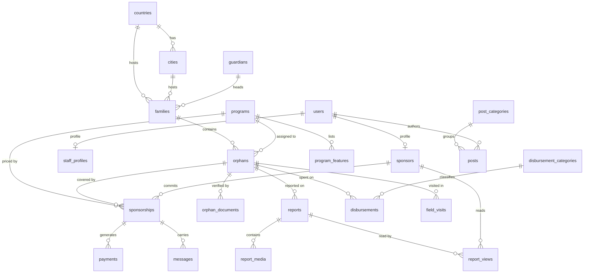

# تصميم قاعدة البيانات — كفالة

> MySQL 8 / MariaDB 10.4+ · InnoDB · `utf8mb4_unicode_ci` · Laravel 12 Migrations
> 31 جدولاً في 9 نطاقات (domains).

---

## 0. المبادئ الحاكمة للمخطّط

هذه القواعد طُبِّقت على كل جدول بلا استثناء، وهي ما يفصل مخطّطاً حقيقياً عن مجموعة جداول:

| # | المبدأ | التطبيق هنا |
|---|---|---|
| 1 | **لا تخزين لما يمكن اشتقاقه** | نخزّن `date_of_birth` لا `age`. العمر يتغيّر كل عام، التاريخ لا. |
| 2 | **استثناء واحد مبرَّر للقاعدة 1** | `orphans.funded_percent` عمود مُخزَّن يُحدَّث بـ Observer — لأن حسابه يتطلب `SUM` على `sponsorships` في كل بطاقة على صفحة تعرض 20 بطاقة. تسريع مقصود وموثّق. |
| 3 | **المال في `DECIMAL` لا `FLOAT`** | كل مبلغ `DECIMAL(12,2)`. `FLOAT` يفقد السنتات في الجمع — غير مقبول في نظام تبرعات. |
| 4 | **كل مبلغ يحمل عملته** | `amount` + `currency` + `fx_rate` + `amount_base` — لأن كافلاً في لندن يدفع بالجنيه وتقرير المؤسسة بالدولار. |
| 5 | **ثلاثة تواريخ لا واحد** | `created_at` (متى أُدخل)، `paid_at`/`spent_on` (متى حدث فعلاً)، `approved_at` (متى اعتُمد). خلطها يفسد كل تقرير مالي. |
| 6 | **`ENUM` للحالات المغلقة، جدول للمفتوحة** | `status` enum لأنه لا يتغيّر إلا بنشر كود. `disbursement_categories` جدول لأن المحاسب يضيف بنداً بلا مبرمج. |
| 7 | **Soft deletes حيث يوجد سجل مالي أو بشري** | لا نحذف يتيماً ولا كفالة ولا دفعة أبداً. الحذف الصلب يكسر التقارير التاريخية. |
| 8 | **لا بيانات دفع حساسة إطلاقاً** | `card_brand` + `card_last4` فقط. لا PAN، لا CVV، لا تاريخ انتهاء. البوابة تحتفظ بها لا نحن. |
| 9 | **`national_id` مُجزّأ لا مخزّن** | `national_id_hash` (SHA-256 + pepper) — يكشف التكرار دون تخزين رقم هوية قابل للتسريب. |
| 10 | **فهرس لكل عمود يُفلتَر أو يُرتَّب به** | وفهارس مركّبة بترتيب الانتقائية الصحيح. |

---

## 1. مخطّط العلاقات (ERD)



---

## 2. النطاق الأول — الهوية والصلاحيات

### `users`

الجدول المركزي. **كل** فاعل بشري في النظام مستخدم: الكافل، والمشرف الميداني، والمحاسب، والمدير.

| العمود | النوع | ملاحظات |
|---|---|---|
| `id` | `BIGINT UNSIGNED PK` | |
| `name` | `VARCHAR(120)` | |
| `email` | `VARCHAR(180) UNIQUE` | |
| `email_verified_at` | `TIMESTAMP NULL` | |
| `password` | `VARCHAR(255)` | bcrypt cost 12 |
| `phone` | `VARCHAR(24) NULL` | صيغة E.164 |
| `avatar_path` | `VARCHAR(255) NULL` | |
| `locale` | `CHAR(2) DEFAULT 'ar'` | يمهّد لـ i18n |
| `timezone` | `VARCHAR(64) DEFAULT 'Asia/Gaza'` | |
| `status` | `ENUM('active','suspended','pending')` | |
| `last_login_at` | `TIMESTAMP NULL` | |
| `two_factor_secret` | `TEXT NULL` | مشفّر |
| `two_factor_confirmed_at` | `TIMESTAMP NULL` | |
| — | `remember_token`, `timestamps`, `deleted_at` | |

**فهارس:** `UNIQUE(email)` · `INDEX(status, last_login_at)`

**الأدوار** عبر `spatie/laravel-permission`. أربعة أدوار: `admin` · `accountant` · `field_supervisor` · `sponsor`.

### `sponsors`

ملف الكافل، **1:1 مع `users`** — لا نحشو أعمدة الكافل في `users` لأن كثيراً من المستخدمين موظفون لا كفلاء.

`user_id UNIQUE FK` · `sponsor_code VARCHAR(16) UNIQUE` (‏`SPN-00412`) · `country_id FK` · `city VARCHAR(80)` · `preferred_currency CHAR(3)` · `prefers_zakat BOOL` · `communication_prefs JSON` · `sponsoring_since DATE` · `internal_notes TEXT` · `timestamps`

### `staff_profiles`

`user_id UNIQUE FK` · `employee_code` · `title` · `assigned_country_id FK NULL` — يقيّد المشرف الميداني ببلده.

---

## 3. النطاق الثاني — الجغرافيا

### `countries`

`id` · `iso2 CHAR(2) UNIQUE` · `iso3 CHAR(3)` · `name_ar` · `name_en` · `flag_emoji` · `currency_code CHAR(3)` · `is_operational BOOL` · `sort_order`

جدول مرجعي بدل النص الحر `'فلسطين'` المتكرر في `data.js` الآن — يمنع `'فلسطين'` و`' فلسطين'` من أن يصبحا دولتين مختلفتين.

### `cities`

`id` · `country_id FK` · `name_ar` · `name_en` · `UNIQUE(country_id, name_ar)`

---

## 4. النطاق الثالث — البرامج

### `programs`

`id` · `slug UNIQUE` · `name_ar` · `name_en` · `icon` · `accent VARCHAR(120)` · `monthly_price DECIMAL(10,2)` · `currency CHAR(3)` · `summary_ar TEXT` · `description_ar TEXT` · `is_featured` · `is_active` · `sort_order` · `timestamps`

**السعر هنا هو المصدر الوحيد للحقيقة.** والكفالة تنسخه لحظة الإنشاء إلى `sponsorships.monthly_amount` — فرفع السعر لاحقاً لا يغيّر التزام كافل قائم. هذا **snapshot pricing**، ومعيار إلزامي في أي نظام اشتراكات.

### `program_features`

`id` · `program_id FK` · `label_ar` · `sort_order`

مُطبَّع بدل مصفوفة JSON — ليعدّله المدير من اللوحة، ويُبحث ويُترجم.

---

## 5. النطاق الرابع — الأيتام والأسر (قلب النظام)

### `guardians` — الوصي

`id` · `full_name` · `relation ENUM('mother','grandmother','father','grandfather','uncle','aunt','sibling','other')` · `phone` · `national_id_hash CHAR(64) NULL` · `date_of_birth NULL` · `occupation` · `monthly_income DECIMAL(10,2) NULL` · `notes` · `timestamps`

### `families` — الأسرة

الطبقة التي تجعل «كفالة الأسرة» ممكنة، وتربط الإخوة تلقائياً بلا جدول self-join.

`id` · `family_code UNIQUE` · `guardian_id FK` · `country_id FK` · `city_id FK` · `address` · `members_count TINYINT` · `monthly_income DECIMAL(10,2)` · `housing_status ENUM('owned','rented','hosted','displaced')` · `timestamps`

### `orphans`

| العمود | النوع | لماذا |
|---|---|---|
| `id` | `BIGINT PK` | |
| `reference_code` | `VARCHAR(16) UNIQUE` | `KFL-1042` — المعرّف العلني |
| `first_name` / `last_name` | `VARCHAR(60)` | مفصولان للفرز وللخصوصية (العرض بالاسم الأول فقط) |
| `gender` | `ENUM('male','female')` | |
| `date_of_birth` | `DATE` | **لا `age`** — العمر accessor |
| `family_id` | `FK` | ومنه الدولة والمدينة والوصي |
| `program_id` | `FK RESTRICT` | |
| `status` | `ENUM('draft','pending_verification','active','fully_funded','graduated','withdrawn','deceased')` | |
| `is_urgent` | `BOOL` | |
| `photo_path` | `VARCHAR(255)` | |
| `grade_level` | `VARCHAR(60)` | |
| `health_status` | `VARCHAR(160)` | |
| `dream` | `VARCHAR(160)` | |
| `story` | `TEXT` | |
| `monthly_need` | `DECIMAL(10,2)` | قد يفوق سعر البرنامج في حالة خاصة |
| `funded_percent` | `TINYINT UNSIGNED DEFAULT 0` | مُشتق مُخزَّن — انظر المبدأ 2 |
| `verified_at` / `verified_by` | `TIMESTAMP` / `FK users` | لا يُنشر يتيم بلا توثيق |
| `published_at` | `TIMESTAMP NULL` | |
| — | `timestamps`, `deleted_at` | |

**الفهارس — كل واحد يخدم استعلاماً حقيقياً في `orphans.html`:**

```sql
INDEX (status, is_urgent, funded_percent)   -- الشبكة الافتراضية: نشط، العاجل أولاً، الأقل تمويلاً أولاً
INDEX (program_id, status)                  -- فلتر البرنامج
INDEX (family_id)                           -- الإخوة
FULLTEXT (first_name, last_name, story)     -- شريط البحث
UNIQUE (reference_code)
```

### `orphan_documents`

`id` · `orphan_id FK CASCADE` · `type ENUM('birth_certificate','death_certificate','medical_report','school_record','photo','guardianship_proof','other')` · `path` · `original_name` · `mime` · `size_bytes` · `uploaded_by FK` · `verified_at` · `verified_by FK` · `timestamps`

هذا الجدول هو ما يجعل ادّعاء «ثلاث مراحل تحقّق» في المدونة **قابلاً للإثبات** بدل أن يكون نصاً تسويقياً.

---

## 6. النطاق الخامس — الكفالات (العلاقة المحورية)

### `sponsorships`

العلاقة بين كافل ويتيم ليست `belongsToMany` بسيطة: لها مبلغ، وحالة، ودورة فوترة، وتاريخ بداية ونهاية. لذا هي **جدول محوري مُثرى (enriched pivot)** لا مجرد `orphan_sponsor`.

| العمود | النوع | ملاحظات |
|---|---|---|
| `id` | `BIGINT PK` | |
| `reference_code` | `VARCHAR(20) UNIQUE` | `KFS-2026-00317` |
| `sponsor_id` | `FK RESTRICT` | |
| `orphan_id` | `FK RESTRICT` | |
| `program_id` | `FK RESTRICT` | |
| `monthly_amount` | `DECIMAL(10,2)` | **منسوخ** لحظة الإنشاء |
| `currency` | `CHAR(3)` | |
| `share_percent` | `TINYINT DEFAULT 100` | كافلان يتقاسمان حالة واحدة |
| `is_zakat` | `BOOL` | يوجّه الحالة للمستحقين زكوياً |
| `status` | `ENUM('pending','active','paused','cancelled','completed')` | |
| `billing_day` | `TINYINT` | 1–28 فقط، تجنّباً لفبراير |
| `started_at` / `next_due_at` / `paused_at` / `ended_at` | `DATE` / `TIMESTAMP` | |
| `cancellation_reason` | `VARCHAR(255) NULL` | |
| `active_key` | `TINYINT GENERATED` | حيلة القيد أدناه |
| — | `timestamps`, `deleted_at` | |

**القيد الذي يمنع الازدواج — وهو الجزء غير البديهي:**

لا يجوز لكافل أن يكفل الطفل نفسه مرتين *في الوقت نفسه*، لكنه **يجوز** أن يعود لكفالته بعد إلغاء. و`UNIQUE(sponsor_id, orphan_id)` العادي يمنع العودة — وهذا خطأ. الحل عمود مُولَّد:

```sql
active_key TINYINT GENERATED ALWAYS AS (
    CASE WHEN status IN ('pending','active','paused') THEN 1 ELSE NULL END
) STORED,
UNIQUE KEY uniq_active_sponsorship (sponsor_id, orphan_id, active_key)
```

`NULL` لا يشارك في قيود `UNIQUE` في MySQL — فالصفوف الملغاة تُستثنى تلقائياً. **قيد جزئي حقيقي على محرّك لا يدعم القيود الجزئية.**

**فهارس:** `INDEX(status, next_due_at)` يخدم أمر الفوترة اليومي · `INDEX(sponsor_id, status)` · `INDEX(orphan_id, status)`

---

## 7. النطاق السادس — المال

### `payments` — المال الداخل

`id` · `reference_code UNIQUE` · `sponsorship_id FK` · `sponsor_id FK` *(مُكرَّر عمداً: تقرير الكافل لا يحتاج JOIN)* · `amount DECIMAL(12,2)` · `currency CHAR(3)` · `fx_rate DECIMAL(12,6)` · `amount_base DECIMAL(12,2)` · `method ENUM('card','apple_pay','bank_transfer','cash')` · `gateway VARCHAR(40)` · `gateway_reference VARCHAR(120)` · `status ENUM('pending','processing','succeeded','failed','refunded')` · `card_brand VARCHAR(20)` · `card_last4 CHAR(4)` · `paid_at TIMESTAMP NULL` · `failure_reason` · `receipt_number VARCHAR(24) UNIQUE NULL` · `idempotency_key VARCHAR(64) UNIQUE` · `timestamps`

> **`idempotency_key` ليس رفاهية.** الكافل يضغط «ادفع» مرتين، أو تعيد البوابة إرسال الـ webhook — وبلا هذا المفتاح يُخصم المبلغ مرتين. وضع `UNIQUE` عليه يجعل الخصم المزدوج مستحيلاً على مستوى المحرّك لا على مستوى الكود.

**فهارس:** `INDEX(status, paid_at)` · `INDEX(sponsor_id, paid_at)` · `INDEX(sponsorship_id, paid_at)`

### `disbursement_categories` — بنود الصرف

`id` · `slug UNIQUE` · `name_ar` · `color VARCHAR(40)` · `sort_order` · `is_active`

البذور: معيشة وغذاء · تعليم · صحة · دعم نفسي وأنشطة · مصاريف إدارية.

### `disbursements` — المال الخارج

`id` · `orphan_id FK NULL` *(‏`NULL` = مصروف إداري عام)* · `category_id FK` · `amount DECIMAL(12,2)` · `currency` · `spent_on DATE` · `description` · `receipt_path` · `recorded_by FK` · `approved_by FK NULL` · `approved_at NULL` · `timestamps`

**هذا الجدول يحوّل حلقة الشفافية من رقم مكتوب يدوياً إلى استعلام:**

```sql
SELECT c.name_ar, c.color,
       ROUND(SUM(d.amount) * 100 / SUM(SUM(d.amount)) OVER (), 1) AS percent
FROM disbursements d
JOIN disbursement_categories c ON c.id = d.category_id
WHERE d.approved_at IS NOT NULL AND YEAR(d.spent_on) = ?
GROUP BY c.id, c.name_ar, c.color
ORDER BY percent DESC;
```

ونسبة «٩٣٪ تصل للطفل» تصبح `1 - (الإداري ÷ الإجمالي)` — رقماً مُدقَّقاً لا وعداً تسويقياً.

---

## 8. النطاق السابع — المتابعة الميدانية

### `reports` — التقرير الربعي

`id` · `orphan_id FK` · `period_year SMALLINT` · `period_quarter TINYINT` · `title` · `summary TEXT` · `academic_note` · `health_note` · `psychosocial_note` · `spending_breakdown JSON` · `visit_date DATE` · `supervisor_id FK` · `status ENUM('draft','submitted','approved','published')` · `approved_by FK` · `published_at` · `timestamps`

**`UNIQUE(orphan_id, period_year, period_quarter)`** — يمنع تقريرين لنفس الربع. وعد «تقرير كل ٣ أشهر» يصير قيداً في المحرّك.

### `report_media`

`id` · `report_id FK CASCADE` · `type ENUM('image','video','document')` · `path` · `caption` · `sort_order`

### `report_views`

`id` · `report_id FK` · `sponsor_id FK` · `viewed_at` · `UNIQUE(report_id, sponsor_id)`

هذا ما يشغّل شارة «تقريران جديدان» في لوحة الكافل — عبر `LEFT JOIN ... WHERE viewed_at IS NULL`، لا برقم مكتوب في HTML كما هو الآن.

### `field_visits`

`id` · `orphan_id FK` · `supervisor_id FK` · `visited_at DATETIME` · `findings TEXT` · `needs_flagged JSON` · `next_visit_due DATE` · `latitude` / `longitude DECIMAL(10,7) NULL` · `timestamps`

رقم «١١,٤٢٠ زيارة موثّقة» يصبح `COUNT(*)`.

### `messages` — رسائل الكافل ↔ الطفل (بوساطة)

`id` · `sponsorship_id FK` · `sender_type ENUM('sponsor','orphan')` · `body TEXT` · `audio_path NULL` · `status ENUM('pending_review','approved','rejected','delivered')` · `reviewed_by FK NULL` · `reviewed_at` · `rejection_reason` · `timestamps`

حالة `pending_review` **افتراضية إجبارياً** — تطبيقٌ لسياسة حماية الطفل المعلنة في الأسئلة الشائعة، على مستوى المخطّط لا على مستوى النيّة.

---

## 9. النطاق الثامن — المحتوى

`post_categories` · `posts` (‏`slug`, `title`, `excerpt`, `body`, `cover_path`, `author_id`, `read_minutes`, `status`, `published_at`, `views_count`) · `faqs` · `testimonials` · `partners` · `settings` (‏`key`/`value`/`group`) · `newsletter_subscribers` · `contact_messages`

---

## 10. النطاق التاسع — التشغيل والتحليلات

### `activity_log`

عبر `spatie/laravel-activitylog`. كل تعديل على يتيم أو كفالة أو دفعة يُسجَّل: من، وماذا، وقبل، وبعد، ومتى، ومن أي IP. **غير قابل للتفاوض في نظام يتعامل مع أموال وأطفال.**

### `daily_metrics` — جدول التجميع (rollup)

```
date PK · sponsored_count · new_sponsorships · cancelled_sponsorships
· active_sponsors · revenue_base · disbursed_base · pending_orphans · urgent_unfunded
```

تملؤه مهمة مجدولة كل ليلة (`php artisan metrics:rollup`).

**لماذا؟** مخطّط «نمو الكفالات آخر ١٢ شهراً» محسوباً على `payments` مباشرة يعني مسح ملايين الصفوف عند كل فتح للوحة. والقراءة من جدول فيه 365 صفاً في العام تجعل الاستجابة أقل من 10ms. **هذا هو الفرق بين لوحة تحكم تعمل ولوحة تتجمّد بعد سنة من الاستخدام.**

---

## 11. سلوك المفاتيح الأجنبية

| العلاقة | السلوك | السبب |
|---|---|---|
| `orphans.family_id` | `RESTRICT` | لا تُحذف أسرة ولها أيتام |
| `sponsorships.orphan_id` | `RESTRICT` | لا يُحذف يتيم وله كفالة |
| `payments.sponsorship_id` | `RESTRICT` | **السجل المالي لا يُمسّ أبداً** |
| `orphan_documents.orphan_id` | `CASCADE` | المستندات تابعة، لا معنى لها منفردة |
| `report_media.report_id` | `CASCADE` | كذلك |
| `*.verified_by` / `*.approved_by` | `SET NULL` | يستقيل الموظف؛ السجل يبقى |

---

## 12. من `data.js` إلى الجداول

| الحالي | يصبح |
|---|---|
| `ORPHANS[8]` مصفوفة ثابتة | `orphans` + `families` + `guardians` + `orphan_documents` |
| `orphan.age` | `date_of_birth` ← accessor |
| `orphan.funded` مكتوب يدوياً | `SUM(sponsorships.monthly_amount) ÷ monthly_need` |
| `orphan.country` نص حر | `families.country_id` → `countries` |
| `PROGRAMS[].features[]` | `program_features` |
| `SPENDING[]` نسب ثابتة | استعلام تجميع على `disbursements` |
| `PROOF.sponsored = 3280` | `COUNT` على `sponsorships` النشطة |
| `PROOF.visits = 11420` | `COUNT` على `field_visits` |
| صفوف `dashboard.html` الثابتة | `sponsorships` + `payments` + `reports` + `report_views` |
| `FAQS` / `POSTS` / `STORIES` / `PARTNERS` | `faqs` / `posts` / `testimonials` / `partners` |
